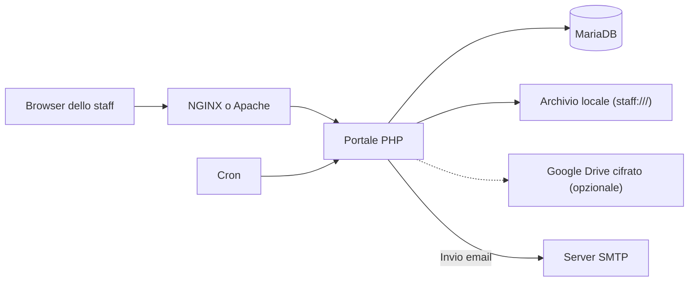

# Portale Staff Amichiamoci

[](https://github.com/Amichiamoci/Staff/actions/workflows/tests.yml)
[](https://github.com/Amichiamoci/Staff/actions/workflows/release.yml)
[](https://github.com/Amichiamoci/Staff/actions/workflows/docker-nightly.yml)
[](https://github.com/Amichiamoci/Staff/actions/workflows/docker.yml)
[](https://github.com/Amichiamoci/Staff/actions/workflows/ftp-deploy.yml)
[](composer.json)

Questo repository contiene il codice sorgente del portale staff, il pannello di controllo di [Amichiamoci](https://www.amichiamoci.it), la manifestazione delle parrocchie di Livorno.

## Funzionalità

- Gestione delle edizioni, delle parrocchie, delle anagrafiche e delle iscrizioni, con documenti di identità, certificati medici e dati per il tesseramento CSI.
- Organizzazione dello staff con account, ruoli di commissione e referenti parrocchiali.
- Gestione di squadre, tornei, calendari, campi, risultati e classifiche.
- Invio di email con l’editor Quill integrato, consultazione delle ultime 500 email e storico completo per destinatario.
- Archivio file locale o su Google Drive con cifratura della sorgente e download soggetti ai permessi del portale.
- API opzionale per le integrazioni e attività periodiche eseguite via cron.

## Architettura



## Installazione

### Docker

Prepara un database MariaDB vuoto con codifica `utf8mb4` e un utente dedicato con permessi per creare tabelle, viste e routine.
Se MariaDB è in un altro container, collega i due container alla stessa rete Docker e usa il nome del servizio come `MYSQL_HOST`.

Configura un file `.env` con le variabili descritte di seguito e limita l’accesso al file con `chmod 600 .env`.
Imposta `ADMIN_USERNAME` e `ADMIN_PASSWORD` per la creazione del primo amministratore.

```sh
docker pull amichiamoci/staff:latest
docker run -d --name amichiamoci-staff --network amichiamoci \
  --env-file .env --publish 127.0.0.1:8080:8080 \
  --volume amichiamoci-data:/amichiamoci/data amichiamoci/staff:latest
```

Il container inizializza lo schema su un database vuoto e avvia il cron.
In produzione, usa un reverse proxy HTTPS che conservi l’host pubblico e imposta `SESSION_COOKIE_SECURE=1`.
Prima di aggiornare un’installazione esistente, salva un backup del database e del volume dati.

### Apache

Installa PHP 8.4 o successivo con `mysqli`, `gd`, `mbstring`, `fileinfo` e `sodium`, Composer 2 e il client `mariadb`.
Installa le dipendenze con `composer install --no-interaction --prefer-dist --optimize-autoloader` e verifica l’ambiente con `composer check-platform-reqs`.

Configura un virtual host HTTPS con `mod_rewrite` e applica `docker/apache.htaccess` nella directory del progetto.
Se usi `.htaccess`, abilita le direttive richieste tramite `AllowOverride`.
Con il portale come `DocumentRoot` puoi anche includere `docker/apache-early.conf` per bloccare i percorsi vietati prima della ricerca sul filesystem.
Usa un formato di log di accesso privo di query string.

Crea le directory `data/documenti`, `data/certificati`, `data/tmp/cron` e `data/log` e rendile scrivibili dall’utente PHP.
Prepara il database e il file `.env`, poi esegui `php script/build-database.php`.
Pianifica `php /percorso/del/progetto/script/cron.php` nel cron di sistema con l’utente del servizio PHP.

## Variabili d’ambiente

Il portale legge le variabili dall’ambiente del processo e dal file `.env` nella radice del progetto.
I valori già presenti nell’ambiente hanno precedenza.
Per ogni variabile del portale puoi usare anche il suffisso `_FILE` per indicare un file che contiene il valore, come `MYSQL_PASSWORD_FILE=/run/secrets/mysql_password`.
La variabile diretta, se impostata, ha precedenza sulla variante `_FILE`.
Conserva credenziali e chiavi in un gestore di segreti o in un file protetto.

### Database e amministrazione iniziale

| Variabile | Uso |
| --- | --- |
| `MYSQL_HOST` | Host o nome del servizio MariaDB, predefinito `localhost`. |
| `MYSQL_PORT` | Porta MariaDB, predefinita `3306`. |
| `MYSQL_USER` | Utente MariaDB, predefinito `amichiamoci`. |
| `MYSQL_PASSWORD` | Password dell’utente MariaDB. |
| `MYSQL_DB` | Nome del database del portale. |
| `ADMIN_USERNAME` | Nome utente del primo amministratore, usato durante l’inizializzazione. |
| `ADMIN_PASSWORD` | Password del primo amministratore, usata durante l’inizializzazione. |

### Sito, accesso e diagnostica

| Variabile | Uso |
| --- | --- |
| `SITE_NAME` | Nome visualizzato nel portale e nelle email, predefinito `Amichiamoci`. |
| `MAIN_SITE_URL` | Indirizzo del sito pubblico, predefinito `https://www.amichiamoci.it`. |
| `DOMAIN` | Host pubblico del portale, usato nei link di recupero e di tracciamento, con ripiego sull’host della richiesta o su `localhost` da CLI. |
| `SESSION_COOKIE_SECURE` | Imposta `1` per contrassegnare i cookie di sessione come sicuri anche quando HTTPS termina sul reverse proxy. |
| `RECAPTCHA_PUBLIC_KEY` | Chiave pubblica reCAPTCHA che abilita la verifica nei moduli di accesso e recupero password. |
| `RECAPTCHA_SECRET_KEY` | Chiave privata per la verifica server di reCAPTCHA quando è abilitato. |
| `ENABLE_API` | Imposta `1` per registrare le route API, disabilitate per impostazione predefinita. |
| `LOG_ROTATING_MAX_FILES` | Numero di file giornalieri da conservare per il log delle richieste, predefinito `14`. |

Gli errori interni sono registrati in `data/log/errors.log` e nel log PHP, che in Docker è visibile anche nell’output del container.

### Posta elettronica

| Variabile | Uso |
| --- | --- |
| `MAIL_OUTPUT_ADDRESS` | Indirizzo mittente impostato nelle email, necessario per l’invio. |
| `SMTP_HOST` | Nome del server SMTP, con ripiego su `localhost`. |
| `SMTP_PORT` | Porta del server configurato con `SMTP_HOST`, predefinita `25`, con TLS implicito sulla porta `465`. |
| `SMTP_USER` | Nome utente per autenticarsi sul server `SMTP_HOST`, con STARTTLS sulle porte diverse da `465`. |
| `SMTP_PASSWORD` | Password per l’autenticazione SMTP. |
| `MAIL_OPEN_SIGNING_KEY` | Chiave di almeno 32 byte per firmare i link di rilevamento delle aperture, disabilitati se la chiave manca o è troppo corta. |
| `CRON_CAPTURE_OUTGOING_ADDRESS` | Indirizzo di prova che sostituisce il destinatario delle email di compleanno inviate dal cron. |

### Archivio e Google Drive

| Variabile | Uso |
| --- | --- |
| `FILE_MAX_SIZE` | Limite applicativo in byte per ogni file caricato, predefinito `10485760` (10 MiB). |
| `VFS_DRIVE_FOLDER_ID` | ID della cartella privata Google Drive. |
| `VFS_DRIVE_CLIENT_ID` | ID del client OAuth per Google Drive API. |
| `VFS_DRIVE_CLIENT_SECRET` | Segreto del client OAuth. |
| `VFS_DRIVE_REFRESH_TOKEN` | Token OAuth con accesso offline in lettura e scrittura alla cartella. |
| `VFS_DRIVE_BASE_KEY` | Chiave di cifratura dell’intera sorgente Drive, codificata in base64 a partire da 32 byte casuali. |

Il portale monta sempre `staff:///` sulla directory `data/`.
Quando tutte e cinque le variabili Drive sono impostate, i nuovi file vengono salvati nella sorgente cifrata `drive:///`.
Genera la chiave una sola volta con `base64_encode(random_bytes(32))` e conservala per rileggere i file.
Prima di aggiornare da una versione che cifrava i file per anagrafica, decifrali con la versione precedente e riscrivili con la chiave di sorgente mantenendo gli URI.

### Esportazione CSI

| Variabile | Uso |
| --- | --- |
| `LEGAL_ADDRESS` | Indirizzo legale esportato nel formato via, civico, comune, CAP e provincia, predefinito `Via del Seminario, 68, Livorno, 57121, LI`. |
| `CODICE_COMITATO_CSI` | Codice del comitato da inserire nell’esportazione CSI. |
| `CODICE_SOCIETA_CSI` | Codice della società da inserire nell’esportazione CSI. |

### Servizi Docker Compose

I servizi MariaDB e phpMyAdmin in `.vscode/docker-compose.yml` usano variabili proprie oltre a quelle del portale.

| Variabile | Uso |
| --- | --- |
| `MYSQL_DATABASE` | Nome del database che il container MariaDB crea quando inizializza il proprio volume. |
| `MYSQL_ROOT_PASSWORD` | Password dell’account root del servizio MariaDB, condivisa con phpMyAdmin nella configurazione locale. |
| `TZ` | Fuso orario del container MariaDB, impostato su `Europe/Rome` nella configurazione locale. |

### Build Docker

| Argomento | Uso |
| --- | --- |
| `PHP_VERSION` | Serie del runtime PHP nell’immagine, predefinita `8.5`. |
| `DEBUG_APP` | Imposta `1` durante la build per includere Xdebug, le dipendenze di sviluppo e la documentazione Doxygen. |

## Verifiche e pubblicazione

GitHub Actions esegue i test in Docker con PHP 8.4, 8.5 e 8.6 e un MariaDB temporaneo.
Dopo i test passa alla pubblicazione dell’immagine `:nighly` su Docker Hub e GHCR a ogni push.

Il workflow manuale **Create GitHub release** verifica il commit e pubblica un tag stabile come `v1.2.3`.
Configura il segreto repository `RELEASE_TOKEN` con il permesso **Contents: Read and write** per attivare i workflow avviati dalla release.
Dopo i test, questi workflow pubblicano le immagini `:latest` e `:v1.2.3` e caricano l’applicazione sul server di produzione via FTP.
Vedi la [documentazione di GitHub Actions](https://docs.github.com/en/actions/using-workflows/triggering-a-workflow).

Per le verifiche locali esegui `sh tests/run.sh PORTA` con Composer 2 e un MariaDB di prova in ascolto su loopback, database `fixture` e utente root locale senza password.
I test usano dati sintetici e un database separato.
Esegui `composer audit --locked` dopo una modifica alle dipendenze.

## Licenze dei componenti inclusi

Quill 2.0.3 è distribuito con [licenza BSD](Public/quill/LICENSE.txt).
[CodiceFiscale.js 2.4.0](https://github.com/lucavandro/CodiceFiscaleJS) è distribuito con [licenza CC BY-SA 4.0](Public/js/codicefiscale.LICENSE.txt).
