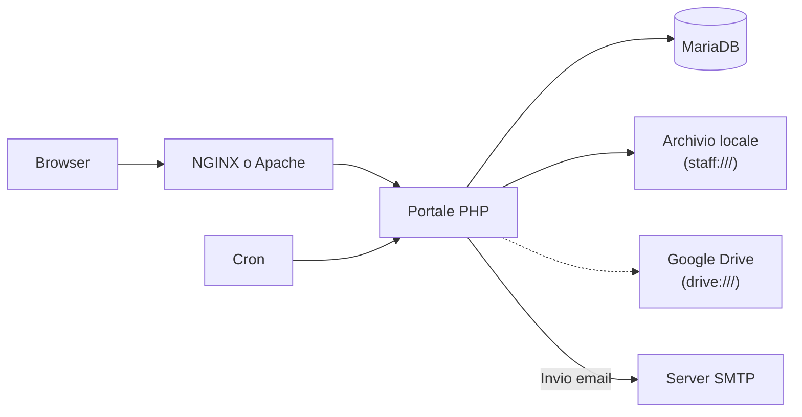

<p align="center">
    
</p>

# Portale Staff Amichiamoci

[](https://github.com/Amichiamoci/Staff/actions/workflows/tests.yml)
[](https://github.com/Amichiamoci/Staff/actions/workflows/release.yml)
[](https://github.com/Amichiamoci/Staff/actions/workflows/docker-nightly.yml)
[](https://github.com/Amichiamoci/Staff/actions/workflows/docker.yml)
[](https://github.com/Amichiamoci/Staff/actions/workflows/ftp-deploy.yml)
[](composer.json)
[](#preparazione-comune-per-apache-e-nginx)
[](#preparazione-comune-per-apache-e-nginx)

Questo repository contiene il codice sorgente del **Portale Staff**, il pannello di controllo di [Amichiamoci](https://www.amichiamoci.it), manifestazione diocesana che si svolge ogni anno a Livorno.

## ✨ Funzionalità

- Gestione delle edizioni, delle parrocchie, delle anagrafiche e delle iscrizioni, con documenti di identità, certificati medici e dati per il tesseramento CSI.
- Organizzazione dello staff con account, ruoli di commissione e referenti parrocchiali.
- Gestione di squadre, tornei, calendari, campi, risultati e classifiche.
- Invio di email con l’editor Quill integrato, consultazione delle ultime 500 email e storico completo per destinatario.
- Archivio file locale o su Google Drive con cifratura della sorgente e download soggetti ai permessi del portale.
- API opzionale per le integrazioni e attività periodiche eseguite via cron.

## 🏗️ Architettura



## ⚙️ Installazione

<h3>
    
    Docker
</h3>

Prepara un database vuoto su MariaDB 12 o successivo oppure MySQL 8 o successivo, in codifica `utf8mb4`, e un utente con permessi per creare tabelle, viste e routine.
Se il server del database è in un altro container, collega i due container alla stessa rete Docker e usa il nome del servizio come `MYSQL_HOST`.

Configura un file `.env` con le variabili descritte di seguito e limita l’accesso al file con `chmod 600 .env`.
Imposta `ADMIN_USERNAME` e `ADMIN_PASSWORD` per la creazione del primo amministratore.

```sh
docker pull amichiamoci/staff:latest
docker run -d --name amichiamoci-staff --network amichiamoci \
  --env-file .env --publish 127.0.0.1:8080:8080 \
  --volume amichiamoci-data:/amichiamoci/data amichiamoci/staff:latest
```

Il container inizializza lo schema su un database vuoto e avvia il cron.
In produzione, usa un reverse proxy HTTPS che conservi l’host pubblico e imposta `SESSION_COOKIE_SECURE=1`.
Prima di aggiornare un’installazione esistente, salva un backup del database e del volume dati.

### Preparazione comune per Apache e NGINX

Installa PHP-FPM 8.4 o successivo con `mysqli`, `gd`, `mbstring`, `fileinfo` e `sodium`, Composer 2 e il client `mariadb`.
Installa le dipendenze con `composer install --no-interaction --prefer-dist --optimize-autoloader` e verifica l’ambiente con `composer check-platform-reqs`.

Prepara un database vuoto su MariaDB 12 o successivo oppure MySQL 8 o successivo, in codifica `utf8mb4`, e configura il file `.env`, includendo le credenziali del primo amministratore.
Crea le directory `data/documenti`, `data/certificati`, `data/tmp/cron` e `data/log` e rendile scrivibili dall’utente PHP.
Esegui `php script/build-database.php` e pianifica `php /srv/amichiamoci/script/cron.php` nel cron di sistema con l’utente PHP.

Gli esempi usano un host locale sulla porta 8080 e presuppongono che il progetto sia in `/srv/amichiamoci`.
Sostituisci il percorso del socket con quello del tuo pool PHP-FPM.
Per un’installazione pubblica configura HTTPS sul server o sul reverse proxy e imposta `DOMAIN` e `SESSION_COOKIE_SECURE=1`.

<h3>
    
    Apache
</h3>

Installa Apache HTTP Server e abilita i moduli rewrite, proxy e proxy_fcgi.

Copia `docker/apache.htaccess` come `.htaccess` nella radice del progetto e abilita il virtual host.
Verifica la configurazione con `apachectl configtest`, quindi ricarica Apache.
Consulta la [documentazione Apache per PHP-FPM](https://httpd.apache.org/docs/2.4/mod/mod_proxy_fcgi.html).

<details>
    <summary>Esempio configurazione Apache</summary>

```apache
Listen 127.0.0.1:8080

<VirtualHost 127.0.0.1:8080>
    ServerName localhost
    DocumentRoot "/srv/amichiamoci"

    <Directory "/srv/amichiamoci">
        Options FollowSymLinks
        AllowOverride FileInfo Options
        Require all granted

        <Files "index.php">
            SetHandler "proxy:unix:/run/php/php8.5-fpm.sock|fcgi://localhost/"
        </Files>
    </Directory>

    CustomLog "/var/log/apache2/amichiamoci-access.log" "%h %t %m %U %>s"
</VirtualHost>
```

</details>

<h3>
    
    NGINX
</h3>

Installa NGINX e avvia il servizio PHP-FPM.

Aggiungi un file per il portale nella configurazione HTTP di NGINX, ad esempio `/etc/nginx/conf.d/amichiamoci.conf`.
Verifica la configurazione con `nginx -t`, quindi ricarica NGINX.
Consulta la [documentazione NGINX per FastCGI](https://nginx.org/en/docs/http/ngx_http_fastcgi_module.html).

<details>
    <summary>Esempio configurazione NGINX</summary>

```nginx
log_format amichiamoci '$remote_addr [$time_local] "$request_method $uri" $status';

server {
    listen 127.0.0.1:8080;
    server_name localhost;
    root /srv/amichiamoci;
    access_log /var/log/nginx/amichiamoci-access.log amichiamoci;

    if ($uri ~* "(^|/)\\.|\\.(php[0-9]*|phtml|phar)([./]|$)") {
        return 404;
    }

    location ~ ^/(css|js|images|quill)/ {
        rewrite ^ /Public$uri last;
    }

    location ~ ^/(Public|docs)/ {
        try_files $uri =404;
    }

    location / {
        include fastcgi_params;
        fastcgi_param SCRIPT_FILENAME $document_root/index.php;
        fastcgi_pass unix:/run/php/php8.5-fpm.sock;
    }
}
```

</details>

## 🔐 Variabili d’ambiente

Il portale legge le variabili dall’ambiente del processo e dal file `.env` nella radice del progetto.
I valori già presenti nell’ambiente hanno precedenza.
Per ogni variabile del portale puoi usare anche il suffisso `_FILE` per indicare un file che contiene il valore, come `MYSQL_PASSWORD_FILE=/run/secrets/mysql_password`.
La variabile diretta, se impostata, ha precedenza sulla variante `_FILE`.
Conserva credenziali e chiavi in un gestore di segreti o in un file protetto.

### 🗄️ Database e amministrazione iniziale

| Variabile | Uso |
| --- | --- |
| `MYSQL_HOST` | Host o nome del servizio MariaDB, predefinito `localhost`. |
| `MYSQL_PORT` | Porta MariaDB, predefinita `3306`. |
| `MYSQL_USER` | Utente MariaDB, predefinito `amichiamoci`. |
| `MYSQL_PASSWORD` | Password dell’utente MariaDB. |
| `MYSQL_DB` | Nome del database del portale. |
| `ADMIN_USERNAME` | Nome utente del primo amministratore, usato durante l’inizializzazione. |
| `ADMIN_PASSWORD` | Password del primo amministratore, usata durante l’inizializzazione. |

### 🩺 Sito, accesso e diagnostica

| Variabile | Uso |
| --- | --- |
| `SITE_NAME` | Nome visualizzato nel portale e nelle email, predefinito `Amichiamoci`. |
| `MAIN_SITE_URL` | Indirizzo del sito pubblico, predefinito `https://www.amichiamoci.it`. |
| `DOMAIN` | Host pubblico del portale, usato nei link di recupero e di tracciamento, con ripiego sull’host della richiesta o su `localhost` da CLI. |
| `SESSION_COOKIE_SECURE` | Imposta `1` per contrassegnare i cookie di sessione come sicuri anche quando HTTPS termina sul reverse proxy. |
| `RECAPTCHA_PUBLIC_KEY` | Chiave pubblica reCAPTCHA che abilita la verifica nei moduli di accesso e recupero password. |
| `RECAPTCHA_SECRET_KEY` | Chiave privata per la verifica server di reCAPTCHA quando è abilitato. |
| `LOG_ROTATING_MAX_FILES` | Numero di file giornalieri da conservare per il log delle richieste, predefinito `14`. |

Gli errori interni sono registrati in `data/log/errors.log` e nel log PHP, che in Docker è visibile anche nell’output del container.

### 📧 Posta elettronica

| Variabile | Uso |
| --- | --- |
| `MAIL_OUTPUT_ADDRESS` | Indirizzo mittente impostato nelle email, necessario per l’invio. |
| `SMTP_HOST` | Nome del server SMTP, con ripiego su `localhost`. |
| `SMTP_PORT` | Porta del server configurato con `SMTP_HOST`, predefinita `25`, con TLS implicito sulla porta `465`. |
| `SMTP_USER` | Nome utente per autenticarsi sul server `SMTP_HOST`, con STARTTLS sulle porte diverse da `465`. |
| `SMTP_PASSWORD` | Password per l’autenticazione SMTP. |
| `MAIL_OPEN_SIGNING_KEY` | Chiave di almeno 32 byte per firmare i link di rilevamento delle aperture, disabilitati se la chiave manca o è troppo corta. |
| `CRON_CAPTURE_OUTGOING_ADDRESS` | Indirizzo di prova che sostituisce il destinatario delle email di compleanno inviate dal cron. |

### 📁 Archivio e Google Drive

| Variabile | Uso |
| --- | --- |
| `FILE_MAX_SIZE` | Limite applicativo in byte per ogni file caricato, predefinito `10485760` (10 MiB). |
| `VFS_DRIVE_FOLDER_ID` | ID della cartella privata Google Drive. |
| `VFS_DRIVE_CLIENT_ID` | ID del client OAuth per Google Drive API. |
| `VFS_DRIVE_CLIENT_SECRET` | Segreto del client OAuth. |
| `VFS_DRIVE_REFRESH_TOKEN` | Token OAuth con accesso offline in lettura e scrittura alla cartella. |
| `VFS_DRIVE_BASE_KEY` | Chiave di cifratura dell’intera sorgente Drive, codificata in base64 a partire da 32 byte casuali. |

Il portale monta sempre `staff:///` sulla directory `data/`.
Quando tutte e cinque le variabili Drive sono impostate, i nuovi file vengono salvati nella sorgente cifrata `drive:///`.
Genera la chiave una sola volta con `base64_encode(random_bytes(32))` e conservala per rileggere i file.
Prima di aggiornare da una versione che cifrava i file per anagrafica, decifrali con la versione precedente e riscrivili con la chiave di sorgente mantenendo gli URI.

### ⚽ Esportazione CSI

Il sistema contiene feature per esportare gli iscritti correnti in un excel supportato dal [Centro Sportivo Italiano](https://www.centrosportivoitaliano.it "Vai al loro sito"), nostro provider assicurativo.

| Variabile | Uso |
| --- | --- |
| `LEGAL_ADDRESS` | Indirizzo legale esportato nel formato via, civico, comune, CAP e provincia, predefinito `Via del Seminario, 68, Livorno, 57121, LI`. |
| `CODICE_COMITATO_CSI` | Codice del comitato da inserire nell’esportazione CSI. |
| `CODICE_SOCIETA_CSI` | Codice della società da inserire nell’esportazione CSI. |

### 🛠️ Build Docker

| Argomento | Uso |
| --- | --- |
| `PHP_VERSION` | Serie del runtime PHP nell’immagine, predefinita `8.5`. |
| `DEBUG_APP` | Imposta `1` durante la build per includere Xdebug, le dipendenze di sviluppo e la documentazione Doxygen. |

## 📦 Immagini Docker disponibili

L'applicazione è disponibile come `amichiamoci/staff` su Docker Hub e come `ghcr.io/amichiamoci/staff` su GitHub Container Registry.

- [Docker Hub](https://hub.docker.com/r/amichiamoci/staff/tags)
- [GitHub Container Registry](https://github.com/orgs/Amichiamoci/packages/container/package/staff)

| Tag | Contenuto |
| --- | --- |
| `:latest` | Immagine della release più recente pubblicata. |
| `:v1.2.3` | Immagine di una specifica release, identificata dal suo numero di versione. |
| `:nighly` | Immagine di sviluppo con le modifiche più recenti, adatta alle prove. |

## 📜 Licenza

Il codice originale del _Portale Staff Amichiamoci_ è distribuito con la [PolyForm Noncommercial License 1.0.0](LICENSE).
La licenza consente di usare, modificare e ridistribuire il codice per finalità non commerciali secondo le condizioni indicate nel testo.
I componenti di terze parti e i servizi esterni restano soggetti alle rispettive licenze e condizioni d’uso.

Per la lista delle licenze di componenti e pacchetti di terze parti inclusi in questo progetto si veda la sezione `extra` del file `composer.json` o la pagina `/credits` del Portale stesso.
